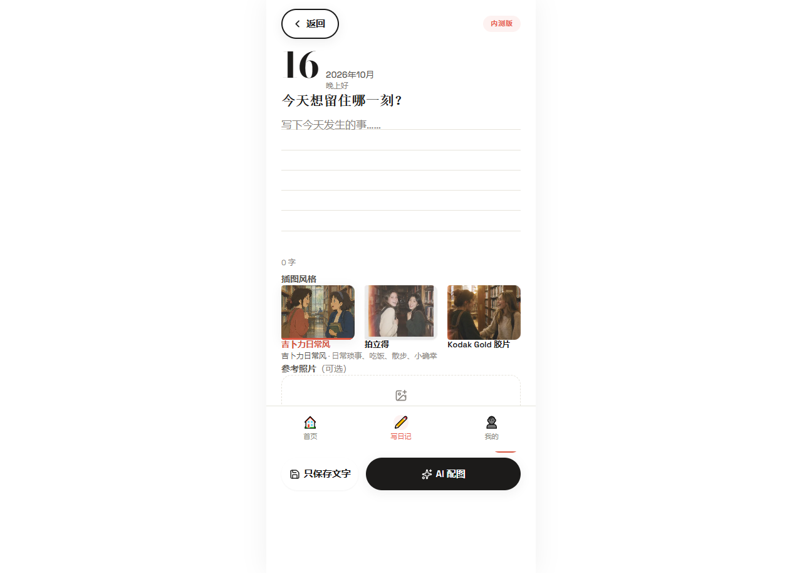
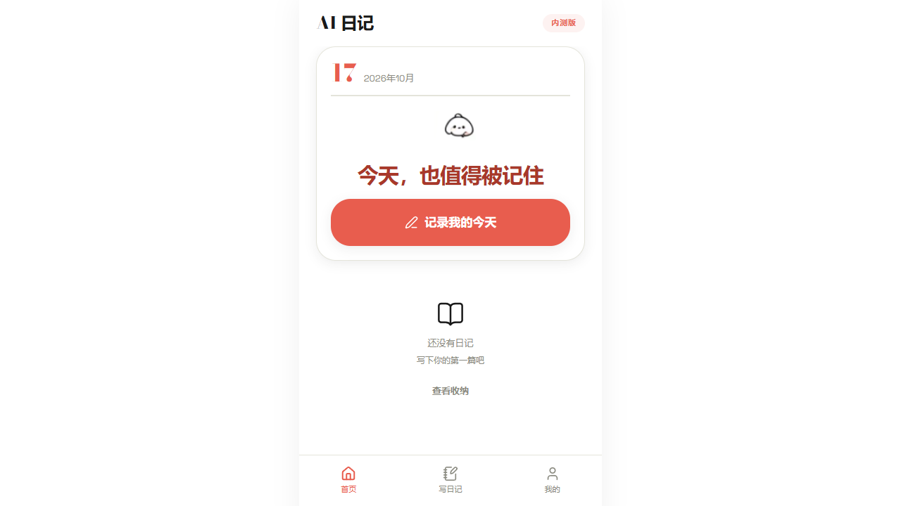
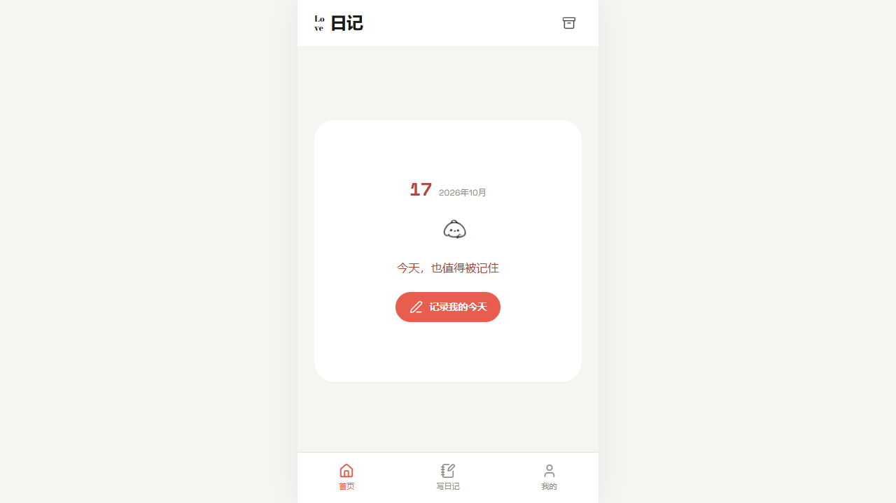

# Illustrated Diary — an AI companion whose memory you can see

  <b><a href="https://www.loveaiyou.xyz">www.loveaiyou.xyz</a></b> ·
  QQ group 爱token: <b>1097902100</b> ·
  <a href="https://1dddd1113sc.github.io/illustrated-diary/">Landing page</a>

> **Every AI companion promises to remember you. We are the only one that can prove it.**

Other companions keep your story as a line of chat text. We turn every day you write into a set of illustrations — same art style, same protagonist, forever. Scroll back three months and the picture is still there, the person in it has not changed. That is what being remembered actually feels like.

---

**Status: the source code is not open.** This repository exists for product showcase, technical writing, and the public roadmap. See [CONTRIBUTING.md](CONTRIBUTING.md) for how to participate. License: proprietary, all rights reserved.

---

## The memory problem with AI companions

The biggest flaw of AI companions is not forgetting — it is that their memory has no weight. A remembered fact buried in a chat log feels like nothing. A remembered day, drawn as a picture you can hold and revisit, feels like a life.

We give memory a body:

| What others call memory | What memory looks like here |
|---|---|
| a string in a chat history | a hand-drawn page in your life album |
| "I remember you" (claim) | the same face, day 1 and day 100 (proof) |
| text you scroll past | pictures you stop at |

## How it works

**1. One diary entry becomes 4-8 illustrated scenes.**
Existing AI diary apps (Day One, Rosebud, Mindsera) turn a whole entry into at most one decorative image. We do event-level segmentation first: the entry is split into concrete moments, each with its own shot composition, lighting, and mood — like a storyboard of your day.

**2. The protagonist never changes.**
From your photos we build a character anchor. "You" on day 1 and "you" on day 100 are the same person, in the same art style. This cross-day consistency is the unsolved problem in every competing product, and it is our core moat.

**3. Failed images never reach you.**
Image generation has a ~10% failure rate. Every generated scene passes an automated consistency/content check; failures are re-prompted and regenerated silently. You press one button and get the full set — no manual retries, ever.

**4. The companion writes with you.**
The AI companion is not a chatbot bolted on the side. It reads your illustrated timeline, remembers what happened — because the memory is anchored to visual scenes, not just tokens — and its side of the diary becomes part of the same album.

## Cost & speed (we publish real numbers)

One 500-word entry → 6 illustrations → about 90 seconds. Cost per entry is tracked per task (tokens / images / provider) and kept low enough that a subscription can cover it. Exact figures are in [docs/architecture.md](docs/architecture.md).

## Screenshots

| Write | Today | Home |
|---|---|---|
|  |  |  |

> TODO: hero GIF (diary text scrolls → scenes light up one by one → timeline swipe). Place at `assets/hero.gif` and it will show at the top.

## Why now

- Event-level illustration for diaries: nobody does it.
- Cross-day character consistency: nobody does it.
- Paid diary subscriptions are proven (Rosebud, Mindsera at $13-15/month).
- Window: roughly 12-18 months before the big players notice.

Full analysis: [docs/market.md](docs/market.md)

## Roadmap

See [ROADMAP.md](ROADMAP.md) — vote on features in Discussions.

## Devlog

We do not open the code, but we open the decisions: what we tried, what failed, what it cost. Devlog entries live in Discussions.

## Participate

- **Discussions**: `Feature requests` (public votes) · `Show your diary` (share your illustrated pages) · `Devlog`
- **Issues**: bug reports and feature requests only — please note the source is not available
